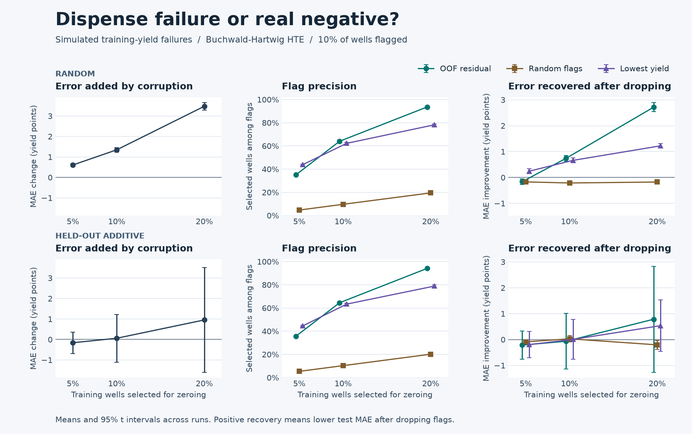

# Dispense failure or real negative?

A simulated well-failure benchmark on public Buchwald-Hartwig high-throughput
reaction yields. These are public measurements with synthetic training faults.
No OnePot lab data or measured dispense-failure labels were used.



## Results

On random splits, dropping residual flags helped at 10% and 20% corruption
and hurt at 5%. At 5%, lowest-yield flags were more precise than residual
flags on both splits. On held-out additives, the intervals for both corruption
cost and residual dropping gain included zero at all three rates.

MAE is in yield percentage points. Positive corruption cost means higher
test error. Positive dropping gain means lower test error after dropping flags.

| Test split | Training wells zeroed | Corruption cost | OOF dropping gain |
| --- | ---: | ---: | ---: |
| Random | 5% | +0.61 [+0.53, +0.68] | -0.16 [-0.27, -0.05] |
| Random | 10% | +1.35 [+1.23, +1.46] | +0.74 [+0.63, +0.85] |
| Random | 20% | +3.47 [+3.29, +3.65] | +2.72 [+2.54, +2.89] |
| Held-out additive | 5% | -0.16 [-0.68, +0.37] | -0.21 [-0.76, +0.33] |
| Held-out additive | 10% | +0.06 [-1.11, +1.23] | -0.07 [-1.14, +1.01] |
| Held-out additive | 20% | +0.95 [-1.60, +3.51] | +0.79 [-1.26, +2.83] |

At 10% corruption, the number of flags equals the number of simulated failures,
so precision and recall are equal.

| Test split | Flagging method | Precision | Recall | Dropping gain |
| --- | --- | ---: | ---: | ---: |
| Random | OOF residual | 64.03% [63.22%, 64.84%] | 64.03% [63.22%, 64.84%] | +0.74 [+0.63, +0.85] |
| Random | Random | 9.67% [8.99%, 10.35%] | 9.67% [8.99%, 10.35%] | -0.21 [-0.27, -0.15] |
| Random | Lowest yield | 62.23% [61.44%, 63.01%] | 62.23% [61.44%, 63.01%] | +0.66 [+0.57, +0.76] |
| Held-out additive | OOF residual | 64.54% [63.59%, 65.49%] | 64.54% [63.59%, 65.49%] | -0.07 [-1.14, +1.01] |
| Held-out additive | Random | 10.29% [9.77%, 10.81%] | 10.29% [9.77%, 10.81%] | +0.03 [-0.09, +0.15] |
| Held-out additive | Lowest yield | 63.34% [62.53%, 64.15%] | 63.34% [62.53%, 64.15%] | +0.01 [-0.76, +0.77] |

## Reproduce

Python 3.13. Run from the repository root.

```sh
python -m pip install -r requirements.txt
python fetch_data.py
python -m unittest -v
python benchmark.py
python plot_results.py
```

The [run-level CSV](results/runs.csv) records counts and scores for every split,
seed, rate, and flagging method. The [summary CSV](results/summary.csv) contains the
full precision, recall, MAE, and paired-difference intervals.

## Setup

- Use 4,132 wells with a recorded yield and all four reagent identities from the
  4,599-row public source table. Of those, 273 already have zero yield.
- Compare 23 seeded 80/20 random splits with 23 folds holding out one complete
  additive at a time. One-hot encode aryl halide, ligand, base, and additive in
  each fit. Unseen categories are all-zero in their feature block.
- Sample exactly the rounded 5%, 10%, or 20% of training wells uniformly without
  replacement and set their yields to zero. Keep the recorded test yields.
  A selected well that was already zero still counts as a simulated failure.
- Flag the 10% of training wells with the largest downward residual (five-fold
  out-of-fold prediction minus observed yield). Compare with uniform random
  flags and lowest observed yields. All methods flag the same number of wells.
  Ties are randomized with a seed. The budget is fixed across rates and splits
  before scoring and uses neither test labels nor injected-fault identities.
- Fit the same 64-tree random forest with a minimum of two wells per leaf on
  clean, corrupted, and trimmed training data. Compare their mean absolute error (MAE) on the same clean test wells.
  Error changes are paired within each run. Values in brackets are 95% Student
  t intervals across the 23 runs per split, with equal weight per run.
  Training sets overlap and all runs reuse one screen. The intervals summarize
  this benchmark, and the injection omits partial or clustered failures.

Data source is [Ahneman et al., Science (2018)](https://doi.org/10.1126/science.aar5169).
The fetch script verifies the [pinned table](https://github.com/doylelab/rxnpredict/blob/57e15fdb7f7483c6bf3a601df69f6ac9e5af6965/data_table.csv)
against its SHA-256 checksum. The upstream repository publishes an
[MIT license](https://github.com/doylelab/rxnpredict/blob/57e15fdb7f7483c6bf3a601df69f6ac9e5af6965/LICENSE.txt).
